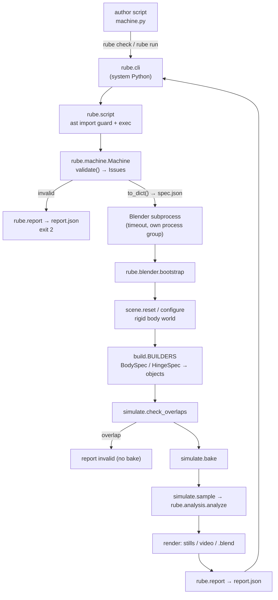

# Design — Rube v1

Implements [`requirements.md`](requirements.md). Where this document and `SPEC.md` differ, the
difference is listed in §9 (Decisions) with its reason; everything else follows `SPEC.md`.

## 1. Architecture overview



Layering (SPEC §3.1). Layer 1 is everything in `rube/` except `rube/blender/`; it never imports
`bpy`, `bmesh` or `mathutils` (NFR-001). Layer 2/3 is `rube/blender/`; it may import Layer 1
(that is how it reconstructs the machine and gets geometry), never the reverse.

## 2. Tech stack

| Choice | Why |
|---|---|
| Python ≥ 3.11 stdlib only for Layer 1 + CLI (dev venv on 3.13) | SPEC §1; no install friction for the author loop. |
| Blender 5.2.3 bundled Python for Layers 2–3 (`bpy`, `bmesh`, `mathutils`) | SPEC §1; only environment with Bullet rigid bodies. |
| `dataclasses` for all specs | Plain data, trivially serializable, no `bpy`. |
| `pytest` (dev) | Unit and Blender-driven acceptance tests. |
| `ruff` (dev) | Lint + format check (clarification Q4). |
| `pyproject.toml` with setuptools, `src/` layout, console script `rube` | SPEC §3.2. |

## 3. Modules and responsibilities

| Module | Layer | Responsibility | Requirements |
|---|---|---|---|
| `rube/__init__.py` | 1 | Re-export public API only (`Machine`, `Vec3`, entities, generators, `Camera`, `Issue`). | — |
| `rube/vec.py` | 1 | `Vec3` frozen dataclass; `as_vec3()` coercion from tuples; small rotation helpers (yaw/axis-angle → 3×3, Euler XYZ). | FR-003 |
| `rube/errors.py` | 1 | `Issue` (frozen), issue-code constants, `RubeValidationError`. | FR-013 |
| `rube/geometry.py` | 1 | `MeshSpec(vertices, faces)`; `box_mesh`, `uv_sphere_mesh`, `cylinder_mesh`, `prism_mesh`, `channel_mesh(path, width, wall_height, thickness)`; `catmull_rom`, `ArcLengthTable` (dense sampling + inversion); AABB helpers. | FR-005–012 |
| `rube/entities.py` | 1 | `PhysicsProps`, `DEFAULTS` table, `COLORS`, base `Entity`, `Floor`, `Ball`, `Block`, `Domino`, `Ramp`; internal `SpiralTrack`, `SupportColumn`, `LeverPlank`, `Fulcrum`; `Hinge` constraint spec; `Group` base; `Lever` group; anchors; per-entity `validate()`; `body()` → `BodySpec`. | FR-004–009, FR-012 |
| `rube/generators.py` | 1 | `domino_chain` → `DominoChain`; `spiral_ramp` → `SpiralRamp`; group-level validation (spacing, turn, flatness, slope, track width). | FR-010, FR-011 |
| `rube/camera.py` | 1 | `Camera.static`, `Camera.follow`, `auto_frame(bboxes)`. | FR-014 |
| `rube/machine.py` | 1 | Registry, naming, `validate()`, `to_dict()` / `from_dict()`, `bodies()` / `constraints()` in build order. | FR-001, FR-002, FR-013, FR-015 |
| `rube/analysis.py` | 1 | Pure analysis of sampled tracks → entity records, events, `UNSTABLE`. | FR-023 |
| `rube/report.py` | 1 | Build / write `report.json`; status ↔ exit code map. | FR-025, FR-018 |
| `rube/script.py` | 1 | AST import guard, script execution, `NO_MACHINE` / `SCRIPT_ERROR`. | FR-016 |
| `rube/cli.py` | runner | `rube check`, `rube run`, Blender discovery, subprocess + timeout. | FR-017, FR-018 |
| `rube/blender/bootstrap.py` | 2/3 | Entry point inside Blender: parse args, run pipeline steps, always write report. | FR-018–025 |
| `rube/blender/scene.py` | 3 | Reset `bpy.data`, units, fps, frame range, rigid body world. | FR-019 |
| `rube/blender/physics.py` | 2 | `add_rigid_body(obj, spec)`, `add_hinge(empty, a, b, spec)` via `temp_override`. | FR-020, FR-012 |
| `rube/blender/build.py` | 2 | `BUILDERS = {BodySpec: build_body, HingeSpec: build_hinge}`; mesh from `MeshSpec` via `from_pydata`; colors; custom props. | FR-020 |
| `rube/blender/simulate.py` | 3 | Overlap check (AABB + BVH), bake, per-frame sampling → `analysis.analyze`. | FR-021–023 |
| `rube/blender/render.py` | 3 | Camera object + constraints, Workbench settings, stills, video, `.blend` save. | FR-014, FR-024 |

## 4. Data model

### 4.1 Layer 1 objects (public)

```
Entity (dataclass, keyword physics fields: dynamic, mass, friction, bounciness, color, name)
├── Floor(size)                         passive box, top at z=0
├── Ball(center, radius)
├── Block(position, size, facing_deg)
├── Domino(position, facing_deg, tilt_deg, size)
├── Ramp(start, end, width, thickness, rails)
└── internal: SpiralTrack, SupportColumn, LeverPlank, Fulcrum
Group (holds .members: list[Entity | Hinge])
├── DominoChain   (.first .last .dominoes .start .end)
├── SpiralRamp    (.entry .exit .ball_spawn(r))
└── Lever         (.left_end .right_end; members: Fulcrum, LeverPlank, Hinge)
Hinge(body_a, body_b, pivot, axis, disable_collisions=True)   not a rigid body
Camera(mode="static"|"follow", position|offset, look_at|target, lens_mm)
```

Unset physics fields are `None` on the dataclass; `resolved_physics()` merges them with
`DEFAULTS[type]` (single table, SPEC §5 / assumption A-1).

### 4.2 Resolved build specs (what Layer 2 consumes)

Each entity's `body()` returns a `BodySpec`; Blender never re-derives geometry.

```python
@dataclass(frozen=True)
class BodySpec:
    name: str; type: str                 # public type name, e.g. "Domino"
    location: Vec3                       # world position of object origin (= center of volume)
    rotation: tuple[tuple[float,...],...]  # 3×3 world rotation matrix (row-major)
    mesh: MeshSpec                       # vertices in local coords, true size
    collision_shape: str                 # SPHERE | BOX | MESH | CONVEX_HULL
    dynamic: bool; mass: float; friction: float; restitution: float
    linear_damping: float; angular_damping: float; margin: float
    use_deactivation: bool; start_deactivated: bool
    color: tuple[float, float, float, float]

@dataclass(frozen=True)
class HingeSpec:
    name: str; body_a: str; body_b: str; pivot: Vec3; axis: Vec3; disable_collisions: bool
```

### 4.3 `spec.json` (output of `Machine.to_dict()`)

```json
{
  "format": 1,
  "name": "machine", "duration": 10.0, "floor": true, "floor_size": 20.0,
  "entities": [ {"type": "Ball", "name": "Ball_1", "center": [0,0,1], "radius": 0.1,
                 "dynamic": null, "mass": null, "friction": null, "bounciness": null, "color": "red"} ],
  "constraints": [ {"type": "Hinge", "name": "Lever_1_hinge", "body_a": "Lever_1_fulcrum",
                    "body_b": "Lever_1_plank", "pivot": [0,0,0.5], "axis": [0,1,0],
                    "disable_collisions": true} ],
  "camera": {"mode": "static", "position": [5,-5,3], "look_at": [0,0,0.5], "lens_mm": 35}
}
```

- `entities` is flat, in build order, and includes the auto floor (first). Each record holds
  the entity's constructor fields (unset physics stay `null`), so `from_dict` rebuilds the
  exact objects through a `type → class` registry and `from_dict(d).to_dict() == d`.
- Groups are flattened (their validation already ran in system Python). The default camera
  is resolved to a concrete `static` camera at `to_dict()` time.

### 4.4 `report.json`

Exactly SPEC §9.2. Status → exit code: `ok 0, invalid 2, bake_failed 3, timeout 4, internal_error 1`.
`internal_error` adds `"traceback": "..."`.

## 5. Interfaces

- **Public API**: SPEC §4–§7 signatures, unchanged.
- **CLI**: `rube check FILE`; `rube run FILE --out DIR [--video] [--timeout SECONDS]`.
- **CLI → Blender**: `Blender -b --factory-startup --python-exit-code 1 --python <src>/rube/blender/bootstrap.py -- --spec DIR/spec.json --out DIR [--video]`.
  `bootstrap.py` prepends the `src/` directory to `sys.path` (derived from its own file path)
  so `import rube` works with Blender's Python without installation.
- **Blender → CLI**: `DIR/report.json`. The CLI reads `status` to choose the exit code. If
  Blender exits without writing a report, the CLI writes `internal_error` with the stderr tail.
- **Analysis input** (`rube.analysis.analyze`): `tracks: list[Track]` where
  `Track(name, type, positions: list[Vec3], rotations: list[3×3])` indexed by frame offset,
  plus `fps`, `frame_start`, `floor_half_size | None`.

## 6. Key algorithms

- **Domino tilt (FR-007)**: rotate the upright box by `tilt_deg` about the horizontal axis
  perpendicular to facing, around the bottom front edge; the resulting center and rotation
  matrix go into `BodySpec`. Pure `vec.py` math.
- **Chain placement (FR-011)**: Catmull-Rom (centripetal is unnecessary for flat smooth
  paths; uniform parameterisation with quadratically extrapolated phantom end points, D-23;
  linear for 2 waypoints) sampled at ≥ 200 points per
  segment; cumulative length table; invert by binary search + linear interpolation to get
  points at `k · spacing`. With `count`, spacing = `L / (count − 1)`. Tangent = finite
  difference on the spline.
- **Ramp spawn (FR-008)**: `p = start + direction · 1.5r` along the top surface, then
  offset by `(r + CLEARANCE)` along the surface normal.
- **Channel mesh (FR-009/010)**: for each path sample, a frame (tangent, horizontal side
  vector, up normal); emit the U cross-section (8 points: outer/inner of floor + two walls)
  and stitch consecutive sections into quads; cap both ends. Solid (closed) so Bullet `MESH`
  shape and BVH overlap work.
- **Overlap (FR-021)**: world-space AABB intersection prefilter, then a BVH overlap test on
  trees built with `BVHTree.FromPolygons` from **world-space** vertices (D-19), plus a
  containment test (one body entirely inside the other); pairs joined by a
  `disable_collisions` hinge and passive–passive pairs are skipped (D-18).
- **Analysis (FR-023)**: speed = |Δposition| · fps between consecutive frames; rotation
  change = angle of `R₀ᵀ·R_f`; tilt = angle between `R_f·ẑ` and `ẑ`.
- **Auto camera (FR-014)**: bounding box of non-floor bodies; look at its center from the
  direction (−1, −1, 0.7) normalised at distance `radius / sin(fov/2) · 1.1`, where
  `radius` = half the box diagonal (min 1 m).

## 7. Error handling, configuration, logging

- Content problems are `Issue`s, never exceptions (`validate()` collects all).
- Constructor arguments are stored as given; type/shape mistakes (e.g. a 2-tuple position)
  become `INVALID_ARGUMENT` at validation, so the author sees all problems at once. Anchor
  properties on an entity with unusable arguments raise `RubeValidationError` with the issue.
- Framework bugs propagate → `internal_error` + traceback (SPEC §9.1).
- Configuration: only `RUBE_BLENDER` env var and CLI flags. Fixed values (fps 24, substeps,
  clearance, thresholds) are module constants, not config.
- Logging: the CLI prints a one-line status and the issues; Blender's stdout/stderr is
  captured into `DIR/blender.log`.

## 8. Testing strategy

| Suite | Runs in | Content |
|---|---|---|
| `tests/unit` | `.venv` pytest | Vec3, every validation code, anchors, chain spacing uniformity and yaw, spiral slope/entry/exit, channel mesh closure, serialization round-trip, camera auto-frame, analysis, report, script guard, CLI (Blender mocked via a fake executable), layering scan (NFR-001, NFR-003). |
| `tests/blender` | `.venv` pytest → `rube run` → Blender | A1–A12 (marked `blender`; skipped when Blender missing), `probe_api.py` (FR-026). A12 uses helper script `tests/blender/check_camera.py` run inside Blender on `machine.blend`. |

Commands: `pytest tests/unit`, `pytest -m blender tests/blender`, `ruff check . && ruff format --check .`.

## 9. Decisions

| ID | Decision | Alternatives rejected | Reason |
|---|---|---|---|
| D-1 | Spec handed to Blender as JSON (`spec.json`), never the author script | Execute script inside Blender | SPEC §3.3: untrusted code stays in system Python. |
| D-2 | Layer 1 resolves every entity to a `BodySpec` (mesh vertices, transform, physics); `BUILDERS` dispatches on spec kind (`BodySpec`, `HingeSpec`) | One builder per entity type; `bpy.ops.mesh.primitive_*` | All geometry unit-testable without Blender (SPEC §3.1); one generic builder is less code and keeps Layer 2 trivial. Sphere vertices are generated in Layer 1 too. |
| D-3 | Meshes created at true size with `mesh.from_pydata`, scale (1,1,1), origin = center of volume by construction | `transform_apply` + `origin_set` (old doc) | SPEC §3.1; avoids context-dependent ops. |
| D-4 | Transform carried as a 3×3 rotation matrix, not Euler angles | Euler XYZ | Composing tilt + yaw is exact; no gimbal/order ambiguity. Layer 2 builds `matrix_world`. |
| D-5 | Groups flattened at `to_dict()`; group validation happens only in system Python | Serialize groups | Blender only needs bodies/constraints; keeps `from_dict` a simple type registry. |
| D-6 | Analysis math in `rube/analysis.py` (Layer 1); `simulate.py` only samples | Analysis in `simulate.py` (SPEC §3.2 layout) | Unit-testable without Blender; same behaviour. |
| D-7 | One report builder `rube/report.py` used by CLI and Blender | Two writers | `report.json` must be identical in shape whoever writes it. |
| D-8 | Follow camera = `COPY_LOCATION(use_offset)` + `TRACK_TO`; never parented | Parenting (old doc) | SPEC §7: parent inherits ball spin. |
| D-9 | Previews via `BLENDER_WORKBENCH` + `render.render(write_still=True)` | `render.opengl` | Fails headless (SPEC §1.1). |
| D-10 | A12 verified by a test-only Blender helper reading `machine.blend` | Extra report fields | Keeps report schema exactly SPEC §9.2. |
| D-11 | Lever hinge = Empty at pivot with `rigidbody.constraint_add(type='HINGE')`; Empty rotated so its local Z = hinge axis | Plank-local constraint | Blender hinges rotate about the constraint object's Z axis. |
| D-12 | Default camera resolved in Layer 1 at `to_dict()` | Compute in Blender | Pure math, testable; Blender just places it. |
| D-13 | Blender tests marked `blender`, skipped if binary missing | Always run | Unit suite stays fast; CI without Blender still works. |
| D-14 | `Block`/`Domino` `position` is the supporting-surface point; `body()` lifts the body by `CLEARANCE` (0.002 m) so it starts just above the surface. Anchors (`top_center`, `front`) describe the resting pose (no clearance). | Exact contact at z = 0 | SPEC §2 "objects start just above surfaces, never intersecting"; exact face contact would trip the frame-1 BVH overlap check (FR-021). 2 mm settles within a frame. |
| D-15 | Entity constructors store arguments as given, coercing positions to `Vec3` / sizes to float tuples only when coercible; anything else is reported by `validate()` (`INVALID_ARGUMENT`). Anchors need valid geometry and raise `RubeValidationError` otherwise. Physics/color problems never block anchors. | Raise in `__init__` | All problems reported in one pass (§7); an anchor on a mis-typed color should not abort the script. |
| D-16 | `Block(size=...)` defaults to `(0.2, 0.2, 0.2)`; default preview colors per type live in `DEFAULTS` (Floor gray, Ball red, Block blue, Domino yellow); `TOO_SMALL` for a ball uses its diameter; `tilt_deg` must be in [0, 90). | Required `size` | SPEC gives no value; forgiving API (§0). |
| D-17 | Entity/Group auto names `<Type>_<n>` come from one per-type counter in registration order, skipping names already taken; group members are named by their own type; hinges `Hinge_<n>`. Names must be non-empty and ≤ 63 bytes (Blender's limit) or `INVALID_ARGUMENT`. | Group-prefixed member names | One rule, predictable for the author; FR-002 "Blender object gets exactly this name". |
| D-18 | The overlap check skips pairs of two passive bodies | Check every pair | Passive bodies never move, so their contact cannot start an explosion; a ramp end or support column resting on the floor would otherwise be a false `OVERLAP`. |
| D-19 | Overlap BVH trees are built with `BVHTree.FromPolygons` from world-space vertices (`matrix_world @ v.co`), and a body fully inside another is caught by a nearest-face inside test | `BVHTree.FromObject` | `FromObject` returns the tree in object-local space, so two trees of different objects cannot be compared directly; triangle overlap alone misses full containment. |
| D-20 | `rube run` deletes a stale `report.json` before starting Blender, and overwrites the report's `elapsed_s` with the CLI's total wall time; `bootstrap` adds the machine's validation warnings to the report | Trust whatever file is there; Blender-only time | A leftover report must never be mistaken for a fresh one (missing-report fallback); authors care about end-to-end time; warnings found by `rube check` belong in the run report too. |
| D-21 | Milestone M2 saves `machine.blend` (trivial `wm.save_as_mainfile`) but renders nothing (`frames: []`); `--video` is accepted and ignored until M4 | Leave `.blend` for M4 | The `.blend` is cheap and useful for inspecting failures now; rendering is M4 (T-014). |
| D-22 | `Ramp` plank: local frame X = downhill `direction`, Y = horizontal across, Z = up normal; box hangs `thickness` below the start→end top centerline; no clearance lift (passive). `exit(distance)` returns a point at **z = 0** (ground top, SPEC "ground-level"). Default color `wood`. Until M5 (T-015), `rails=True` is reported as `INVALID_ARGUMENT` instead of being silently ignored | `exit` at `end.z`; ignoring `rails` | Ground level is what the next part (dominoes) stands on; refusing an unimplemented option tells the author instead of building something different. |
| D-23 | Catmull-Rom phantom end points are extrapolated quadratically (`P₋₁ = 3P₀ − 3P₁ + P₂`; linearly `2P₀ − P₁` for 2 waypoints), not duplicated | Duplicated end points (first design) | Duplicates force the end tangent onto the chord to the next waypoint: 3 waypoints on a quarter circle then turn only 45°, and an L-shaped corner sags and turns up to 30° between neighbours. The quadratic phantom follows the parabola through the end waypoints, so arc-like waypoints give a smooth ~90° turn (A4). The curve still passes through every waypoint. `domino_chain` builds no dominoes from unusable arguments (each would repeat the same issue); the chain's `validate()` reports them once. |
